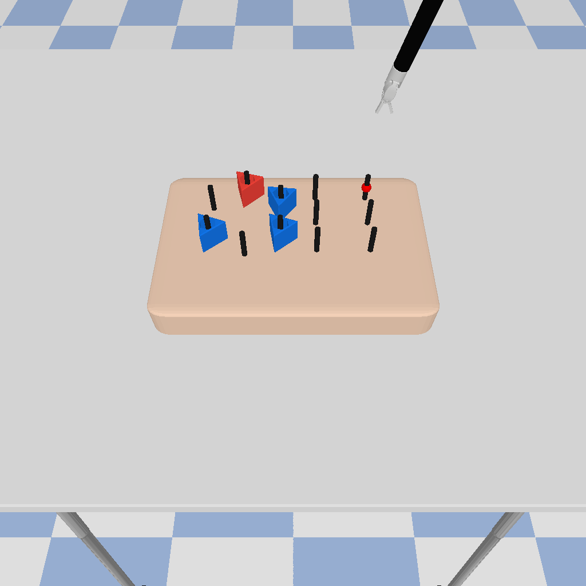
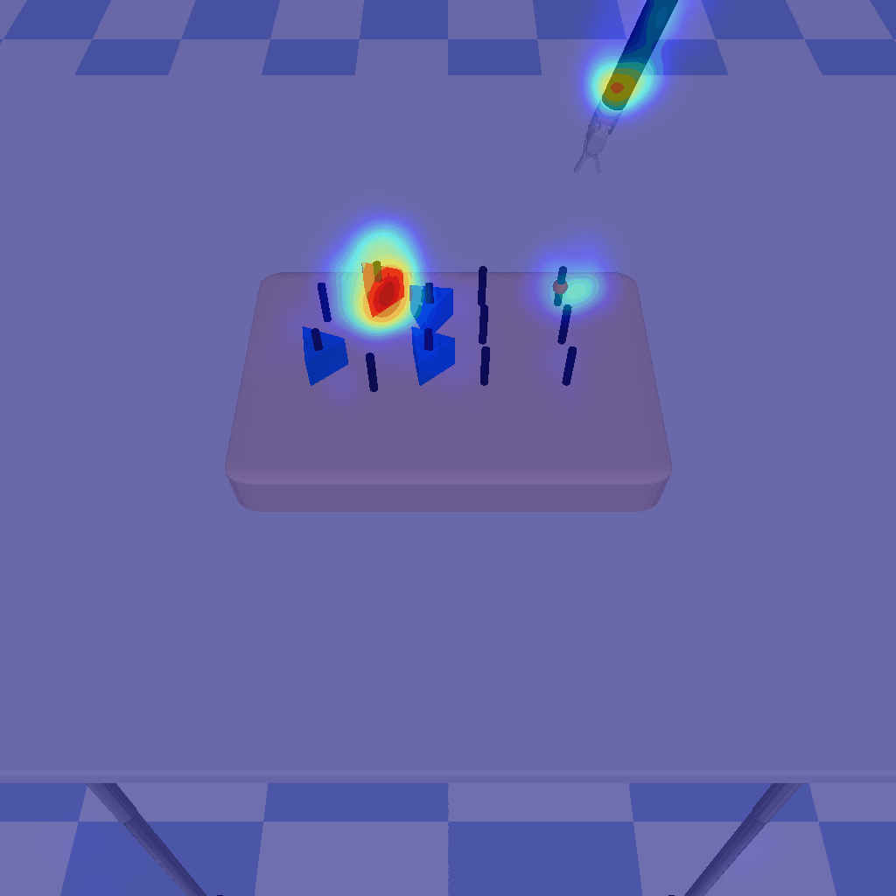

# Revisiting Distribution Matching for State-to-Vision Policy Distillation in Laparoscopic Robotic Manipulation

[Mingyu Sheng](https://scholar.google.com/citations?user=P7MIBuMAAAAJ&hl=en&oi=ao)<sup>1</sup>,
[Jianan Fan](https://ieeexplore.ieee.org/author/37090057230)<sup>1</sup>,
[Dongnan Liu](https://scholar.google.com/citations?hl=en&user=JZzb8XUAAAAJ)<sup>1</sup>,
[Guoyan Zheng](https://scholar.google.com/citations?user=n01L0mEAAAAJ&hl=en&oi=ao)<sup>2</sup>,
[Ron Kikinis](https://scholar.google.com/citations?user=n01L0mEAAAAJ&hl=en&oi=ao)<sup>3</sup>,
[Weidong Cai](https://scholar.google.com/citations?hl=en&user=N8qTc2AAAAAJ)<sup>1</sup>

<sup>1</sup> [The University of Sydney](https://www.sydney.edu.au/), 
<sup>2</sup> [Shanghai Jiao Tong University](https://hms.harvard.edu/),
<sup>3</sup> [Harvard Medical School](https://hms.harvard.edu/)

## 📄Paper Link
TODO: [TODO](http://)

Arxiv: [https://arxiv.org/abs/2511.05059](https://arxiv.org/abs/2511.05059)

## 🖼️Concept Figure


## 💻Setup
* Recommended Environment: Python 3.12.0+, Cuda 12.0+
* Install dependencies: `pip install -r requirements.txt`.


## 💨Train State-Based (Teacher) Policy

```bash
python main.py --train --test --config_file demo_train_teacher.yaml
```


## 💨Train Vision-Based (Student) Policy

```bash
python main.py --train --test --config_file demo_train_student.yaml
```


## ⚙️Config File

Config files are stored in `./ConfigFiles`. The config file defines the experiment configuration, such as iterations, learning rate, etc..


## ⚙️Sample Results




## Acknowledgements

This project leverages the [SurRoL](https://med-air.github.io/SurRoL/) as simulator.


## 📝Citation

Journal/Conference: 

```
TODO
```


arXiv:

```
TODO
```


