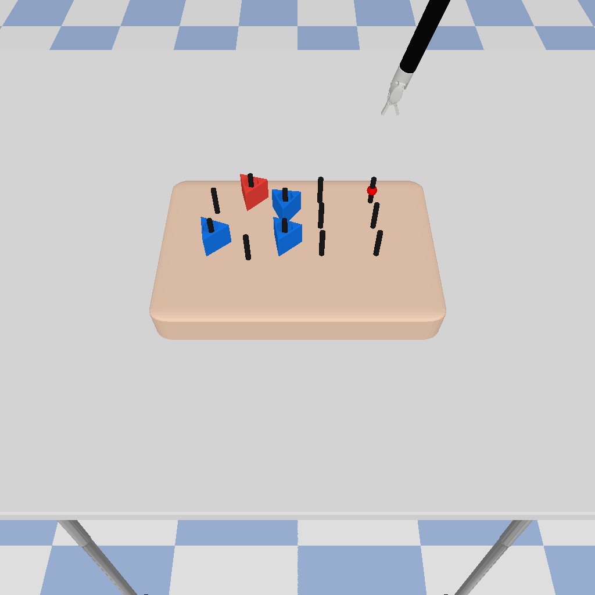
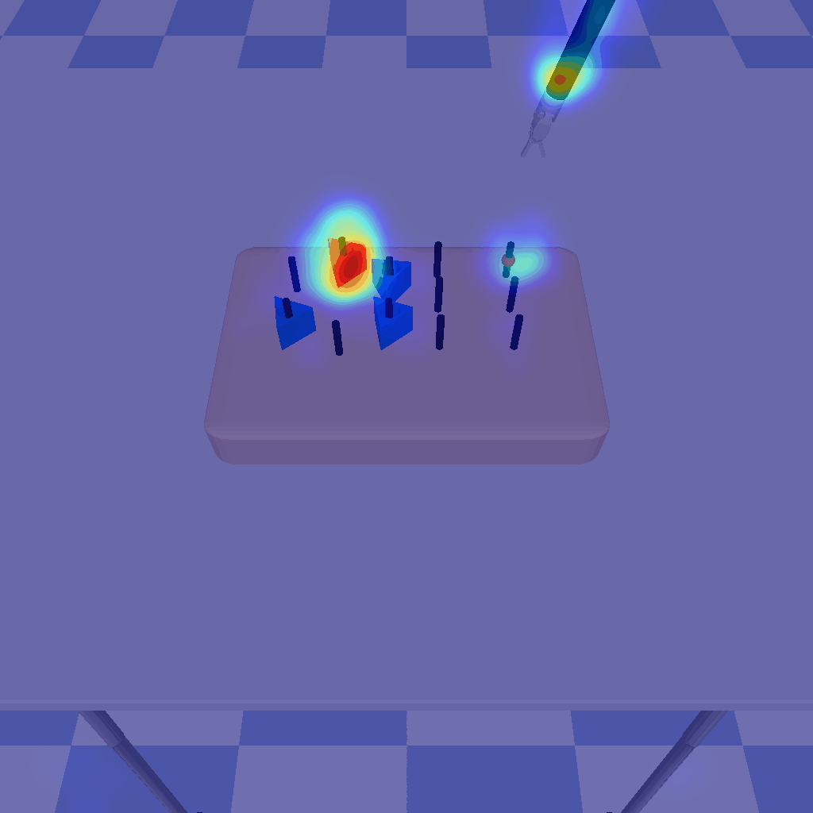

# Revisiting Distribution Matching for State-to-Vision Policy Distillation in Laparoscopic Robotic Manipulation

Anonymous

## 📄Paper Link
TODO: [TODO](http://)

Arxiv: [TODO](https://arxiv.org/abs/2610.31010)

## 🖼️Concept Figure


## 💻Setup
* Recommended Environment: Python 3.12.0+, Cuda 12.0+
* Install dependencies: `pip install -r requirements.txt`.


## 💨Train State-Based (Teacher) Policy

```bash
python main.py --train --test --config_file demo_train_teacher.yaml
```


## 💨Train Vision-Based (Student) Policy

```bash
python main.py --train --test --config_file demo_train_student.yaml
```


## ⚙️Config File

Config files are stored in `./ConfigFiles`. The config file defines the experiment configuration, such as iterations, learning rate, etc..


## ⚙️Sample Results




## Acknowledgements

This project leverages the [SurRoL](https://med-air.github.io/SurRoL/) as simulator.


## 📝Citation

Journal/Conference: 

```
TODO
```


arXiv:

```
@misc{sheng2026revisitingdistributionmatchingstatetovision,
      title={Revisiting Distribution Matching for State-to-Vision Policy Distillation in Laparoscopic Robotic Manipulation}, 
      author={Mingyu Sheng and Jianan Fan and Dongnan Liu and Guoyan Zheng and Ron Kikinis and Weidong Cai},
      year={2026},
      eprint={2610.31010},
      archivePrefix={arXiv},
      primaryClass={cs.RO},
      url={https://arxiv.org/abs/2610.31010}, 
}
```


